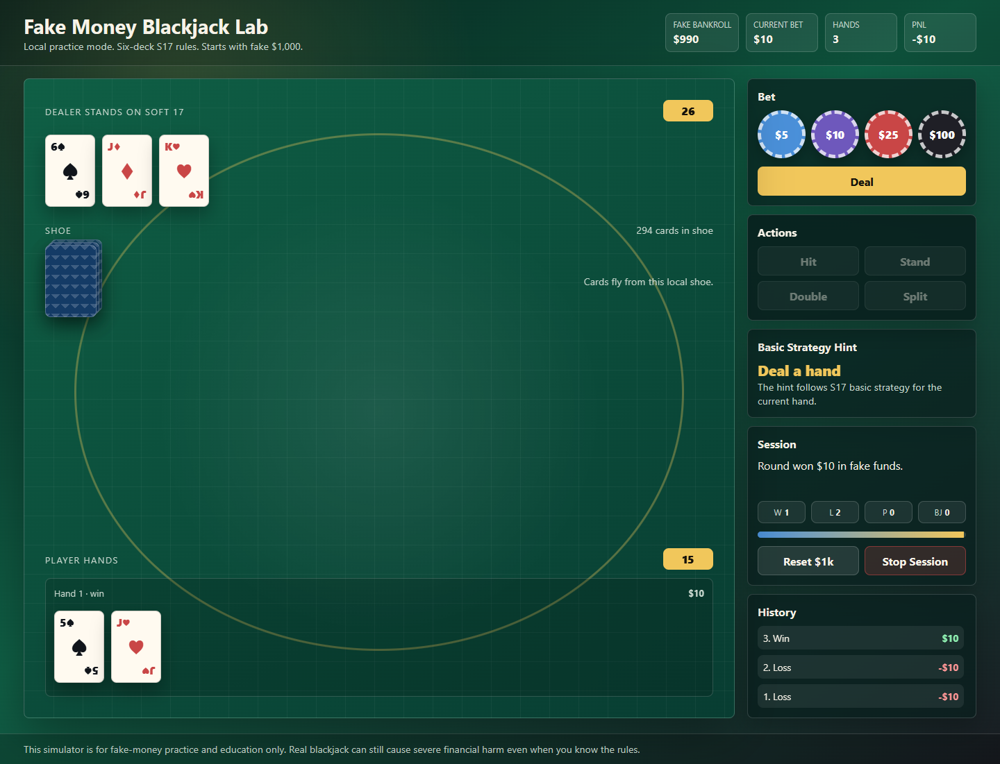

# Blackjack Simulator & PnL Lab

Play hands with a fake bankroll in the browser, then use a seeded Python simulation to compare how two betting rules perform on the same sequence of rounds.



## What it does

- The browser table models a six-deck shoe, dealer stands on soft 17, 3:2 blackjack, hits, stands, doubles and splits. A strategy hint explains the current hand, and the session panel records outcomes and bankroll changes.
- The Python CLI deals each round once and applies flat betting and a Hi-Lo wager ramp to the same outcome. It can export one row per strategy per round with the cards, decisions and bankroll data for independent analysis.

The two implementations serve different purposes. [The table](index.html) is a single HTML file with vanilla JavaScript and in-memory session state. [The CLI](blackjack_pnl_sim.py) uses the Python standard library and separates shoe, hand decisions, round settlement and strategy accounting.

## Run locally

From the repository root, use Python 3.10 or later.

```sh
python -m http.server 8000 --bind 127.0.0.1
```

Open [the local table](http://127.0.0.1:8000/index.html), choose a chip, deal and play a hand. Use **Stop Session** to disable dealing or **Reset $1k** to clear the session.

Run the analysis in a separate terminal.

```sh
python blackjack_pnl_sim.py --hands 100000 --seed 42 --unit 1 --bankroll 10000 --out blackjack_results.csv
```

## Verification

The local Chromium run selected a $10 chip, settled three hands, confirmed the corresponding history entries, stopped the session and verified that reset restored $1,000 and cleared history. The screenshot shows the browser after the three rounds.

Two CLI runs with Python 3.14, seed 42, 100,000 rounds, one-unit base bets, 75% shoe penetration and a 10,000-unit starting bankroll produced byte-identical CSV files with 200,000 data rows. The same simulated rounds feed both strategies.

| Strategy | Winning rounds | Losing rounds | Pushes | PnL (units) | Maximum drawdown (units) |
| --- | ---: | ---: | ---: | ---: | ---: |
| Flat | 43,236 | 47,919 | 8,845 | −554.00 | 739.50 |
| Hi-Lo ramp | 43,236 | 47,919 | 8,845 | +1,112.50 | 827.00 |

<details>
<summary>Terminal output</summary>

```text
Blackjack PnL summary
strategy hands  wins  losses pushes blackjacks win_rate total_pnl roi     avg_pnl max_dd bankroll busted
-------- ------ ----- ------ ------ ---------- -------- --------- ------- ------- ------ -------- ------
flat     100000 43236 47919  8845   4594       43.236%  -554.00   -5.540% -0.0055 739.50 9446.00  no
hilo     100000 43236 47919  8845   4594       43.236%  1112.50   11.125% 0.0111  827.00 11112.50 no
```

CSV SHA-256 from both runs: `8a464b6f4b6e7855fedda955f3217da782f69e65b15d417a7b4b17519a8b9853`.

</details>

## Status and limitations

This is a local educational simulator. Browser sessions reset on reload. The table and CLI implement the rules separately, and the repository has no rules-parity suite. The table above reports a single seeded run and provides no estimate of long-run expected value or uncertainty.
